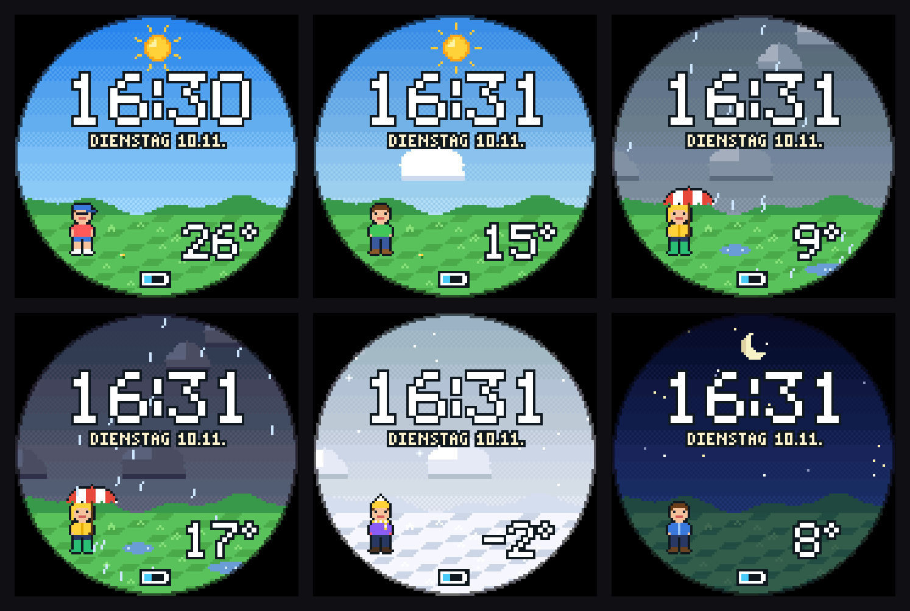
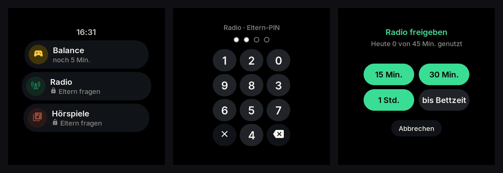
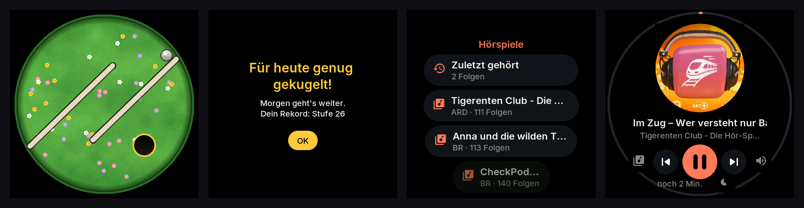

# Pixeluhr

Eine Kinderuhr auf dem **Waveshare ESP32-S3-Touch-AMOLED-1.75C** (rund, 466 × 466) und dem
**ESP32-S3-Touch-AMOLED-2.16** (eckig, 480 × 480): ein 8-Bit-Zifferblatt mit Uhrzeit und Wetter, das Kugelspiel
**Balance**, **Radio** und **Hörspiele** aus der ARD Audiothek. Spielen und Hören gibt es nur, wenn die Eltern es
freigeben – mit der Eltern-PIN an der Uhr oder in der Weboberfläche – und höchstens so viele Minuten pro Tag, wie sie
eingestellt haben. Hervorgegangen aus [Taschenfunk](https://github.com/tobwil/esp-gadget), aber nur noch für Kinder.

```
firmware/   PlatformIO-Projekt (Arduino-Core 3.3 / ESP-IDF 5.5, LVGL 9.2)
tools/      Bauen, Updates per WLAN, Fernsteuerung und Bildschirmfotos über USB, Schrift- und Zertifikat-Generatoren
tests/      Zifferblatt-Vorschau, Prüfung der Weboberfläche, Test auf der Uhr
docs/       Bilder
```

## Zifferblatt



Große Pixel-Uhrzeit, darunter Wochentag und Datum, dahinter das Wetter von gerade eben (Open-Meteo, Standort per IP):
Sonne, Wolken, Regen mit Pfützen, Gewitter mit Blitzen, Schnee, Nebel – nachts Mond und Sterne. Regen, Schnee und
Wolken bewegen sich. Auf der Wiese steht die Temperatur, ganz unten der Akku und eine Note, wenn etwas läuft.

## Bedienung

| Wo | Geste / Taste | Wirkung |
|---|---|---|
| Zifferblatt | antippen, ↑ hochwischen | Apps (läuft etwas: die Wiedergabe) |
| Zifferblatt | ↓ runterwischen | Kontrollzentrum: Lautstärke, Helligkeit, Display aus |
| Zifferblatt | **1,5 s gedrückt halten** | Eltern-Menü (mit Eltern-PIN) |
| überall | → nach rechts wischen | zurück |
| überall | am Rand entlang ziehen | Lautstärke (solange etwas läuft) |
| überall | **BOOT** | Zifferblatt: Apps · sonst: zurück zum Zifferblatt |
| überall | **PWR** kurz / lang | Display an/aus · Ausschalten/Neustart |
| dunkles Display | **Doppeltipp** | Display an |

## Freigaben und Minuten pro Tag



Die Apps zeigen ihren Stand: **„Eltern fragen“**, **„noch 12 Min.“**, **„Für heute aufgebraucht“** oder
**„Schlafenszeit“**. Tippt das Kind eine gesperrte App an, erscheint das Ziffernfeld für die **Eltern-PIN** – die
Ziffern stehen jedes Mal woanders, Mitlesen über die Schulter hilft also nicht; nach drei falschen Versuchen ist eine
Minute Pause. Danach wählen die Eltern, wie lange: **15 Min., 30 Min., 1 Std.** oder **bis zur Bettzeit**. Dasselbe
geht in der Weboberfläche.

- **Minuten pro Tag** je App, getrennt für **Mo–Fr** und **Sa & So** (10 Minuten bis 3 Stunden oder ohne Grenze).
  Voreinstellung: Balance 15/30, Radio und Hörspiele je 45/60 Minuten.
- **Gezählt wird nur echte Nutzung**: Spielen bzw. Hören, nicht das Herumtippen in Listen.
- **Freigabe und Limit zusammen:** Eine Freigabe läuft nach der Uhr ab („frei bis 15:40“), das Tageslimit zählt
  Minuten. Was zuerst endet, gilt. Geben die Eltern an der Uhr oder unter „Heute“ mehr frei, als das Limit noch
  zulässt, gibt es die fehlenden Minuten heute extra.
- **Sanftes Ende:** Zwei Minuten vorher ein Hinweis. Die laufende Balance-Stufe darf zu Ende gespielt werden
  (höchstens 3 Minuten länger), Radio und Hörspiele werden über 20 Sekunden ausgeblendet.
- **Ohne Freigabe** (Schalter je App in der Weboberfläche): Dann gilt nur das Tageslimit, keine PIN nötig – z. B.
  für Hörspiele am Wochenende.
- Neuer Tag um Mitternacht. Stand, Freigaben und die letzten sieben Tage überstehen Neustarts.

## Balance, Radio, Hörspiele



- **Balance:** Uhr neigen, Kugel rollen lassen. **Ins Ziel** (Mauern, Labyrinthe, Blockaden, ein paar Fallen) und
  **Alle Kugeln** (drei Kugeln in drei Löcher, auf Zeit). Die Rekorde zeigt die Weboberfläche.
- **Radio:** nur Sender, die die Eltern freigegeben haben (aus radio-browser.info oder den ARD-Livestreams, z. B.
  KiRaKa). Weiter/Zurück wechselt den Sender.
- **Hörspiele:** freigegebene Sendungen der ARD Audiothek (alle Folgen) oder einzelne Folgen. Jede Folge merkt sich
  die Stelle, „Zuletzt gehört“ steht oben in der Liste. Sleep-Timer über den Mond.
- **Lautstärke** mit Obergrenze (Standard 60 %).

## Schlafenszeit

Von der Bettzeit bis zum Aufstehen (Standard 19:30 bis 6:30) ist alles gesperrt und das Display gedimmt. Was beim
Zubettgehen läuft, darf noch die **Einschlafzeit** lang weiterlaufen (Standard 30 Minuten) und wird dann sanft
ausgeblendet. Mit **Nachtruhe** (Standard an) geht die Uhr danach bis zum Aufstehen in den Tiefschlaf – in Etappen von
höchstens zwei Stunden, dazwischen stellt sie ihre Uhr per WLAN nach.

## Eltern-Menü an der Uhr

Zifferblatt 1,5 s gedrückt halten, Eltern-PIN: Balance, Radio und Hörspiele **freigeben oder sperren**, **WLAN**
einrichten, **QR-Code** zur Weboberfläche, **Eltern-PIN** festlegen oder ändern (4 Ziffern, zweimal), Infos, Neustart.
Raus geht es mit **Fertig**, BOOT oder nach rechts wischen; geht das Display aus, ist das Menü beim nächsten Einschalten
zu (offene Freigabe-Dialoge auch). Ist noch keine PIN gesetzt, öffnet sich das Menü ohne Abfrage – die Apps lassen sich
dann gar nicht freigeben, und auch das Kind könnte dort eine PIN festlegen. Deshalb gleich zu Anfang eine PIN setzen.

## Weboberfläche

`https://<IP der Uhr>` bzw. `https://pixeluhr-xxxx.local` (QR-Code im Eltern-Menü; `http://` leitet um). Fürs Handy
gebaut, hell und dunkel. Ist eine Eltern-PIN gesetzt, fragt die Seite sie über ein Zahlenfeld ab (auch per Tastatur);
der Browser merkt sie sich danach. Reiter:

- **Heute:** je App der Stand, die heute genutzten Minuten, Knöpfe **15 Min. · 30 Min. · 1 Std. · bis Bett** und
  **Jetzt sperren**; die Woche als Balken; Wetter, Bettzeit; „Uhr klingeln lassen“.
- **Regeln:** Minuten pro Tag (Mo–Fr, Sa & So) und „Ohne Freigabe“ je App, Aufstehen, Bettzeit, Einschlafhören,
  Nachtruhe, Lautstärke-Grenze, Eltern-PIN festlegen oder ändern (Zahlenfeld, zweimal), Balance-Rekorde.
- **Hören:** Fernbedienung (abspielen, Pause, weiter, Lautstärke, Sleep-Timer – auch nachts und ohne Freigabe, die Zeit
  zählt trotzdem), die Freigabeliste, **Suchen und Stöbern** in Radio und ARD Audiothek mit 🧸 + zum Freigeben, zuletzt
  gehörte Folgen.
- **Gerät:** Akku mit Verlauf und Restlaufzeit, Sparmodus, Tiefschlaf, Name, Display, WLAN, Firmware-Update, Neustart.

Direkt verlinkbar: `#heute`, `#regeln`, `#hoeren`, `#geraet`. Die Uhr stellt sich ein eigenes Zertifikat aus, deshalb
warnt der Browser einmal („trotzdem öffnen“); danach ist die Verbindung verschlüsselt, auch die PIN.

## Einrichten

1. **Firmware bauen und aufspielen** (Uhr per USB-C anstecken):
   ```bash
   sh tools/build.sh amoled-175c upload   # rund (1.75C)
   sh tools/build.sh amoled-216 upload    # eckig (2.16)
   ```
   ESP-IDF verträgt keine Leerzeichen im Projektpfad; `tools/build.sh` baut in dem Fall eine Kopie unter `/tmp`.
   Ohne Leerzeichen geht auch `cd firmware && pio run -t upload`. Erkennt der Rechner das Board nicht: **BOOT**
   halten, kurz **PWR** drücken, BOOT loslassen, erneut hochladen.
2. **WLAN:** Zifferblatt 1,5 s gedrückt halten → Eltern-Menü → WLAN.
3. **Eltern-PIN** festlegen (Eltern-Menü oder Weboberfläche → Regeln).
4. In der Weboberfläche unter **Hören** Sender und Hörspiele freigeben und unter **Regeln** die Minuten einstellen.

**Updates per WLAN:** Weboberfläche → Gerät → Firmware, oder vom Rechner
`sh tools/ota.sh <Adresse der Uhr> amoled-175c <PIN>`. Die Uhr prüft, ob die Datei für ihr Board gebaut ist.

Kommt die Uhr von Taschenfunk, bleiben WLAN, Eltern-PIN, Freigaben (Radio und Audiothek), Bettzeit, Lautstärke, Balance-Rekorde und die
Stellen in angefangenen Folgen erhalten.

## Akku

Wird nichts gestreamt, schläft das WLAN zwischen den Beacons des Routers; bei dunklem Display döst die Uhr im
Leichtschlaf und bleibt für die Weboberfläche erreichbar. Der **Sparmodus** (automatisch ab 20 %) begrenzt Helligkeit
und Display-Zeit. Tagsüber auf Wunsch **Tiefschlaf** nach 10/30/60 Minuten mit dunklem Display (dann weckt nur BOOT).
Bei 10 % eine Warnung, bei 3 % schaltet die Uhr geordnet aus.

## Testen

```bash
sh tests/run_host.sh                                    # am Rechner: Zifferblatt-Vorschau, Weboberfläche, beide Builds
~/.platformio/penv/bin/python tests/test_device.py      # auf der Uhr (USB + WLAN), lautlos; --pin 1234, falls gesetzt
```

- **Am Rechner:** `tests/face_preview.cpp` zeichnet das Zifferblatt für alle Wetter, Tag und Nacht
  (`tests/out/zifferblatt.png`) und prüft, dass nichts außerhalb des Rasters landet.
  `tests/check_webui.py` prüft das Skript der Weboberfläche (Syntax, IDs, Routen).
- **Auf der Uhr:** Zifferblatt mit Testwetter, Freigeben und Sperren, Balance mit vorgetäuschter Neigung (Zeit wird
  gezählt, Tageslimit beendet das Spiel), Hörspiele, Weboberfläche (Seite, Zustand, PIN, 404, Freigabe über die API).
  Genutzte Minuten, Sperren und Lautstärke werden danach wiederhergestellt; die PIN bleibt unberührt.

Fernsteuerung über USB:

```bash
~/.platformio/penv/bin/python tools/remote.py /dev/cu.usbmodem* tap 233 233 wait 1 shot bild.png
```

Befehle im seriellen Monitor: `tap X Y`, `hold X Y [ms]`, `swipe l|r|u|d`, `boot`, `pwr`, `shot`, `dump` (alle Texte mit
Lage), `status`, `page apps|music|game|control|parent`, `home`, `open game|radio|stories`, `browse radio|stories`,
`unlock game 15` (Minuten, −1 = bis zur Bettzeit), `lock radio`, `used stories 30` (heute genutzte Minuten),
`weather 63 9 day|night` (Testwetter, `weather off`), `level 3`, `tilt 0.3 -0.2` / `tilt off`, `vol 40`,
`toggle`, `next`, `stop`, `wifi SSID PASSWORT`, `pin 1234` / `pin -` (Eltern-PIN setzen/löschen), `poweroff`.

## Technik

- **Display:** CO5300 über QSPI (Arduino_GFX), LVGL 9.2 mit Bildpuffern im PSRAM. Das Zifferblatt wird als
  116 × 116-Pixelbild gezeichnet (`faceart.cpp`, ohne LVGL) und ×4 vergrößert.
- **Audio:** ES8311 über I2S mit 44,1 kHz, ein Mischer-Task für Musik und Klänge mit weicher Lautstärke. Das Mikrofon
  (ES7210) wird abgeschaltet.
- **Hören:** MP3-Spieler (libhelix, Resampling) mit Range-Anfragen und gemerkter Position, Radio live mit ICY-Titeln
  und Neuverbinden. Sender über radio-browser.info, Audiothek über GraphQL (api.ardaudiothek.de), Cover über den
  Bild-Proxy wsrv.nl.
- **Weboberfläche:** esp_https_server mit selbst ausgestelltem EC-Zertifikat (397 Tage, Name und IP als SAN); der
  HTTPS-Task übergibt jede Anfrage an die Hauptschleife.
- **Module:** `main` · `hw`, `audio`, `net`, `power`, `imu`, `weather` · `kids` (PIN, Bettzeit, Freigabeliste),
  `quota` (Freigaben, Minuten pro Tag, Verlauf) · `music` mit `player`, `webradio`, `ard`, `art` · `server`, `webui`
  · `faceart` · `ui/` (Zifferblatt, Apps, PIN und Freigabe, Eltern-Menü, Balance, Wiedergabe, Kontrollzentrum).
